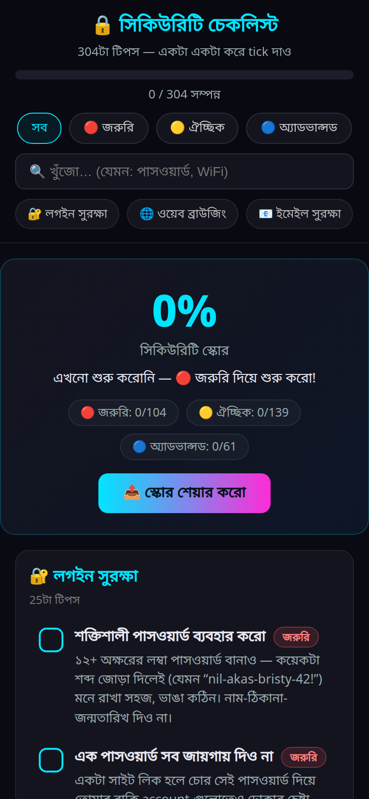
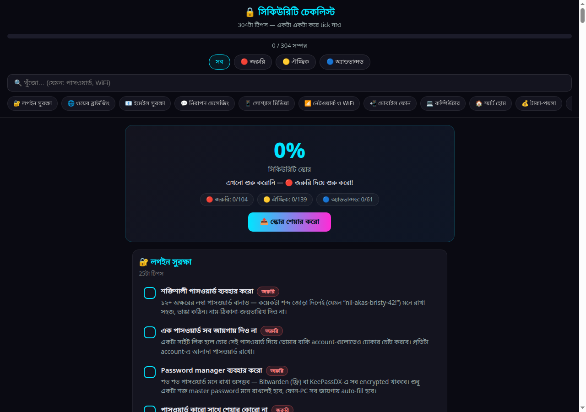

# 🔒 বাংলা সিকিউরিটি চেকলিস্ট

**৩০৪টা** digital security ও privacy tips — সম্পূর্ণ বাংলায়।
Tick দিয়ে নিজের progress track করো, security score দেখো, বন্ধুদের সাথে শেয়ার করো।

🌐 **Live demo:** https://samiul14.github.io/bangla-security-checklist/

| 📱 Mobile | 🖥️ Desktop |
| :---: | :---: |
|  |  |

## ✨ Features

- 📋 **৩০৪টা tips** — ১২টা section জুড়ে
- 🔴🟡🔵 **Priority filter** — জরুরি / ঐচ্ছিক / অ্যাডভান্সড
- 🔍 **Live search** — যেকোনো topic সাথে সাথে খুঁজো
- 📊 **Security score** — তোমার সুরক্ষার শতাংশ + 📤 শেয়ার বাটন
- 💾 **Progress save** — tick দিলে browser-এ মনে রাখে
- 🇧🇩 **বাংলাদেশ-specific tips** — বিকাশ/Nagad fraud, OTP scam, কুরিয়ার প্রতারণা, ৯৯৯...
- 📱 **Mobile-first** — single HTML file, কোনো build বা install লাগে না

## 📑 Sections

| Section | Tips |
| :--- | ---: |
| 🔐 লগইন সুরক্ষা | 25 |
| 🌐 ওয়েব ব্রাউজিং | 43 |
| 📧 ইমেইল সুরক্ষা | 23 |
| 💬 নিরাপদ মেসেজিং | 22 |
| 📱 সোশ্যাল মিডিয়া | 19 |
| 📶 নেটওয়ার্ক ও WiFi | 27 |
| 📲 মোবাইল ফোন | 28 |
| 💻 কম্পিউটার | 37 |
| 🏠 স্মার্ট হোম | 14 |
| 💰 টাকা-পয়সা | 18 |
| 🧠 সচেতনতা | 30 |
| 🔒 ফিজিক্যাল সিকিউরিটি | 18 |

## 🚀 ব্যবহার

শুধু `index.html` browser-এ খুললেই হবে — কোনো server, build বা install লাগে না।

## 🤝 Contribute

নতুন tips-এর idea থাকলে
[issue](https://github.com/samiul14/bangla-security-checklist/issues) খুলো বা pull request দাও।

## 🙏 Credit

- মূল checklist:
  [lissy93/personal-security-checklist](https://github.com/lissy93/personal-security-checklist)
  (CC BY 4.0)
- বাংলা রূপান্তর: [Samiul](https://github.com/samiul14)

## 📄 License

[CC BY 4.0](LICENSE) — https://creativecommons.org/licenses/by/4.0/
